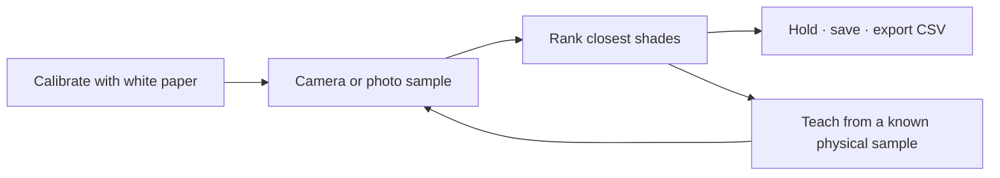

# Color Detector

A phone-camera app for aluminium warehouses: point the camera at a profile and
it names the closest shade from the [Klil colour fan](https://www.klil.co.il/גוונים/)
(44 shades, 4 families), with its code, finish and how close the match is.

It is a static web app (PWA). There is nothing to install from a store and no
server: open the page on the phone, allow the camera, and optionally "Add to
Home Screen" so it runs full-screen and offline. Hebrew and English UI.

> Unofficial. Not affiliated with Klil. See [Accuracy](#accuracy) before
> relying on it.

## At a glance




## Using it

1. **Calibrate** – tap *Calibrate white*, fill the square with white paper in
   the light you work in, tap *Calibrate now*. Repeat when the lighting changes.
2. **Scan** – aim the square at the profile (10–15 cm away, slightly tilted to
   avoid glare). The closest shade, two alternatives and the colour difference
   (ΔE, lower is closer) update live.
3. **Hold / Save** – *Hold* freezes the reading; *Save* logs it to History,
   which can be exported as CSV.
4. **Teach** – if the app is wrong, tap *Wrong match? Teach the correct shade*
   and pick the real one. The reading is stored as that shade's reference and
   used from then on. Doing this once per shade from real samples is the single
   biggest accuracy improvement.

No camera permission? *Photo* lets you take or pick a picture and tap the spot
to sample.

## Accuracy

Read this before trusting a result.

- **The reference colours are approximations.** The values in `colors.js` are
  the swatch colours published on Klil's website – screen renderings of powder
  coatings, not measured references. Teaching shades from physical samples
  replaces them with real measurements from your own phone and lighting.
- **A phone camera is not a colorimeter.** Auto white balance, auto exposure
  and warehouse lighting all shift what the camera sees. White calibration
  corrects most of it. On Android Chrome the app also locks exposure and white
  balance after calibrating; iOS Safari does not allow that, so results there
  drift more – keep white paper around the profile in the frame.
- **Some shades cannot be separated by colour.** These groups are within
  ΔE 2.5 of each other on the website and the app flags them instead of
  guessing: 34F/34I, 95F/66I, 12F/73F/15I, 17I/16F/16I/77I. Several differ
  mainly in texture (FINE IRON vs IRON), which a colour reading cannot see.
- **Confidence labels** are based on ΔE to the best match: ≤ 4 good, ≤ 8
  likely, above that uncertain.

Treat the app as a fast first check. Before cutting or shipping, confirm
against a physical fan deck or the profile label.

## Putting it on a phone

The camera only works over HTTPS, so the app has to be hosted. With GitHub
Pages:

1. Repository → **Settings → Pages**.
2. *Source*: **Deploy from a branch**, branch **main**, folder **/ (root)**, Save.
3. After a minute the app is at `https://fadi7ay.github.io/Color-Detector/`.

## Development

```sh
npm start   # serves on http://localhost:8080 (camera works on localhost)
npm test    # unit tests for the colour maths and matching
```

No build step and no dependencies.

| File | Purpose |
| --- | --- |
| `colors.js` | The catalogue: code, website colour, finish, family, names |
| `color.js` | sRGB → Lab, CIEDE2000, glare-resistant sampling, white calibration |
| `matcher.js` | Ranking, confidence, near-identical shades, learned samples |
| `app.js` | Camera, UI, storage |
| `i18n.js` | Hebrew / English strings |
| `sw.js` | Offline cache |

To add or correct a shade, edit the table in `colors.js`. English shade names
are unofficial translations of the Hebrew ones.

Calibration, learned samples and history are stored on the phone only
(`localStorage`); nothing is uploaded.
